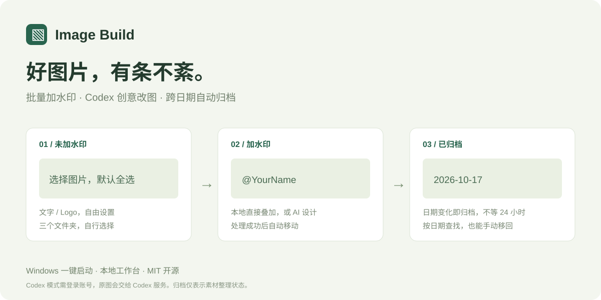

# Image Build · 本地图片工作台

**从 AI 图片到带签名的作品，再到整齐的素材库。一个本地工作台完成。**

Local image watermarking, Codex-powered creative edits, and calendar-based archiving.



[下载最新版本](https://github.com/hskelp9527-pixel/image-build/releases/latest) · [反馈问题](https://github.com/hskelp9527-pixel/image-build/issues/new/choose) · [参与贡献](CONTRIBUTING.md) · [更新记录](CHANGELOG.md)

给 AI 生成图片批量加上自己的文字或 Logo 水印，并按日期整理。中文界面，支持本地直接叠加和唤醒 Codex 创意改图两种方式，不接入 X API。本地模式不需要账号或 AI 模型。

## Windows 一键启动

1. 从 [Releases](https://github.com/hskelp9527-pixel/image-build/releases/latest) 下载 `ImageBuild-Windows-source.zip` 并解压，双击 **`start.bat`**。这是唯一的批处理入口，首次会自动准备环境。
2. 按提示完成 Codex 账号登录，工作台随后自动打开。平常仍然双击同一个 `start.bat`。安装脚本会复用已有环境，通过 Windows `winget` 安装缺失的 Python、Node.js LTS，通过 npm 安装 Codex CLI，并安装图片处理依赖、启用生图功能。首次需要联网，系统可能弹出安装权限提示。
3. 浏览器自动打开工作台，首次选择三个文件夹。可以在文件夹选择窗口新建文件夹，也可以粘贴绝对路径。

启动窗口保持打开。关闭网页不会停止后台；在启动窗口按 `Ctrl+C` 可停止。再次双击启动脚本会打开已有工作台。端口被其他程序占用时会尝试后续端口。

## 三个文件夹，三个 Tab

| 分类 | 用法 |
| --- | --- |
| 未加水印 | 放入原图，支持 JPG、JPEG、PNG、WebP、BMP、TIF、TIFF，读取子文件夹。默认选中尚未处理的图片，也可取消全选、单张选择。 |
| 加水印 | 成功处理的图片移入这里，按 `YYYY-MM-DD` 分目录输出 PNG，第一栏对应源文件移除。从此文件夹选图发到 X。 |
| 已归档 | 手动选择第二栏图片归档，或跨天自动归档。可选中图片“移回加水印”，重新从今天计时。 |

三个文件夹都可随时在“文件夹设置”中修改，不能相同或互相包含。更换设置只切换读取位置，不搬迁旧文件。个人路径、Logo 和处理记录保存在项目的 `.local/` 中，已被 Git 忽略；移到另一台电脑时请重新选择当地的文件夹。

工作流使用移动语义：图片只出现在当前阶段。水印成品完整写入并校验成功后，移除第一栏的源文件；失败图片保留。归档或移回使用真实文件移动。旧版留下的已处理原图，在确认对应成品可读后自动清出第一栏。处理后不会再保留无水印版本，如需原始素材请在工作流外自行保存。

环境未安装、未登录或未启用 CLI 生图时，工作台会显示具体原因和 `start.bat` 入口。Windows 自动安装需要可用的“应用安装程序”（winget）；如不可用，手动安装 Python 3.10+、Node.js LTS，再运行 `start.bat`。账号登录需要用户本人完成，无法随开源项目预置。

### 日期归档的确切规则

- **归档不代表已经发布**，本工具不读取 X，也不自动判断是否已使用。
- 本地水印和 Codex 成品都带文件名时间戳（`原名__YYYYMMDD_HHMMSS_微秒.png`）和 PNG 内嵌时间戳 `ImageBuildCreatedAt`、`ImageBuildReadyAt`，记录电脑本地生成时间与时区。
- 比较图片进入时间戳的本地日期和电脑当前本地日期，只要已经跨日期就归档，**不计算是否满 24 小时**。例如 23:59 生成，次日 00:00 即可归档；当天 00:01 生成，在当天 23:59 仍保留。
- 文件改名或移动后仍可读取内嵌时间戳。旧版本图片沿用已有日期记录；外部图片无内嵌时间戳和历史记录时，以文件修改时间为准。
- 开启自动归档时，将进入日期早于电脑本地今天的图片移到 `已归档/进入日期/`。今天进入的图片保留到第二天。
- 归档任务绑定 `start.bat` 启动的后台进程，启动时立即检查，期间每 30 秒检查并在午夜单独触发。关闭网页不影响归档；退出启动进程或关机后暂停，下次启动补做。
- 只自动移动“加水印”里的图片，未加水印的原图不会自动移动。源目录中的空日期子文件夹保留。
- 手动归档无需等待跨天；重名时添加数字后缀，不覆盖原文件。跨磁盘移动使用复制后删除方式。
- 从归档移回第二栏时重新写入进入时间戳，按移回当天计时，同时保留最初的生成时间戳。

## 水印设置

处理方式可选择“直接加水印”或“唤醒 Codex”。直接加水印在本地叠加；Codex 模式可填写改图要求，例如把账号融入画面中的招牌、调整字体和光影。

### Codex 创意改图

本机需安装并登录支持 `image_generation` 功能的 Codex CLI。`start.bat` 会准备环境，无需 Codex 桌面端，无需粘贴提示词或 API Key。

- 点击“自动执行 Codex 改图”后，工作台直接调用 `codex exec`，在独立任务目录后台执行。用户需求通过标准输入提交，不经过 shell 拼接。保留用户默认模型与登录配置，启用 `image_generation`，使用 `workspace-write` 和不等待审批模式。
- 选中原图的副本、水印文字或 Logo、完整改图要求保存到 `.local/codex-jobs/<任务编号>/`。Codex 模式会把图片交给所用 Codex 服务，不属于离线处理。
- Codex 将成品写入任务的 `output/`，最后生成 `result.json` 清单；任务结束时立即校验并导入，页面每 5 秒刷新。成功导入才移除第一栏源文件，重复刷新不会重复导入。
- 任务固定导入到启动时选择的第二个文件夹。运行中修改文件夹设置不改变已有任务的目标位置。
- 如果生图能力不可用，会在任务中保留原因，不会用本地叠加冒充 AI 改图，也不自动切换付费 API。

任务文件夹保留提示词、日志和处理清单；成功图片的暂存输入、输出会清理。失败图片不移出第一栏，可在任务卡片点击“自动执行 / 重试”。上一版本准备好但尚未发送的任务，也可以直接在卡片自动执行。

安装、登录和功能开关检查通过，不等于模型网络一定可达。请求超时、模型不可用或生图失败会在任务里显示原因，源文件保留，不会伪报成功。

### 日期查看

三个 Tab 上方都有日期按钮，显示日期和图片数量。点击某个日期仅显示该日图片，点击“全部日期”恢复。全选、归档和移回只作用于当前日期可见的选中图片。归档日期优先使用处理记录或 `已归档/YYYY-MM-DD/` 目录名，不会因复制文件保留了其他修改时间而错分组。

### 本地叠加选项

文字默认 `@Alexvhyn`，支持修改文字、颜色、位置、大小、不透明度。Logo 支持上传图片，透明 PNG 效果最好。先选图再点“预览本地叠加效果”，预览的是选中列表中的第一张。设置作用于整批选中图片，点击“直接加水印”后保存设置。

水印直接叠加，不重新生成画面。处理 EXIF 方向，保持画面像素尺寸，输出 PNG；原有 EXIF、GPS 等元数据不带入输出。动态及多页图片不支持，失败图片会单独提示，不影响其余图片。大批量图片逐张处理，等待期间不要关闭启动窗口。

图片在处理期间若被外部程序修改，会保留新的源文件，避免误移除。任务处理记录按“路径 + 文件大小 + 修改时间”识别。

字体优先使用系统字体。Windows 使用微软雅黑以支持中文。其他系统如需稳定显示中文，可将有授权的中文字体放在 `fonts/watermark.ttf`（不随项目提供字体）。

## 开发与其他系统

```sh
python -m venv .venv
# Windows:
.venv\Scripts\python -m pip install -r requirements.txt
.venv\Scripts\python app.py
# macOS / Linux:
.venv/bin/python -m pip install -r requirements.txt
.venv/bin/python app.py
```

macOS / Linux 的原生目录选择需要 tkinter；未安装时可在设置中直接粘贴路径。主要验收环境为 Windows。

可选参数：`python app.py --no-browser --port 8765`。可通过环境变量 `IMAGE_BUILD_DATA` 指定配置数据目录。网页只监听 `127.0.0.1`，写操作使用本次启动生成的令牌。

```sh
.venv\Scripts\python -m unittest discover -s tests -v
```

主要结构：`app.py` 负责图片与文件操作，`templates/` 和 `static/` 提供界面，`choose_folder.py` 打开原生目录选择器，`start.ps1` 准备环境。

## 开源

采用 [MIT License](LICENSE)。欢迎通过 [Issues](https://github.com/hskelp9527-pixel/image-build/issues) 报告问题或提出需求，也欢迎提交 Pull Request。贡献流程见 [CONTRIBUTING.md](CONTRIBUTING.md)。

`.venv/`、`.local/`、日志及个人素材不随发布包提供。项目不附带用户图片、Logo、账号凭证或第三方字体。介绍图使用项目自行绘制的示意图。当前以 Windows 为主要使用和验证环境。
